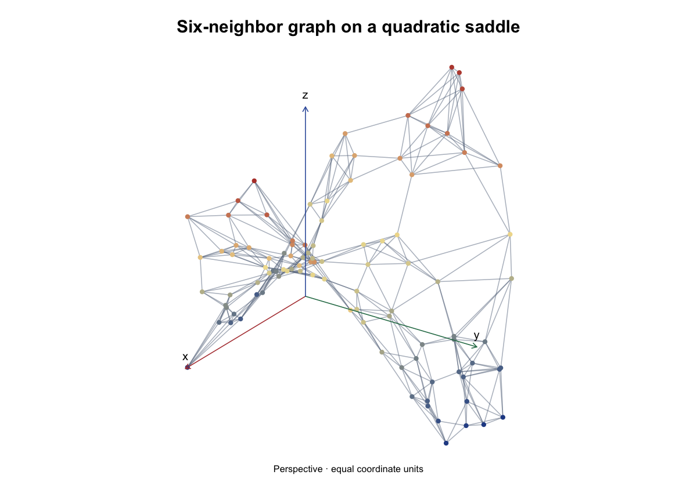

# dgraphs

`dgraphs` constructs and analyzes graphs derived from numerical observations.
It includes mutual and shared-neighbor graphs, intersection and geodesic
nearest-neighbor graphs, radius and adaptive-radius graphs, minimum-spanning-tree
completion, and Fermat-distance graphs. It also provides graph conversion,
pruning, diagnostics, spectral embedding, endpoint and path utilities, intrinsic
simplex distances, and reproducible synthetic geometries and point sampling.
Optional tools include iterated adaptive neighborhood (IAN) graphs and an
interactive graph explorer.

## Installation

This README describes **dgraphs 0.4.0**, the planned CRAN update from **0.2.0**.
Version 0.4.0 has not yet been released on CRAN. The examples below use its API;
see [NEWS](NEWS.md) for changes and migration guidance.

Install the published release from CRAN and check its version:

```r
install.packages("dgraphs")
library(dgraphs)
packageVersion("dgraphs")
```

Until 0.4.0 is published, this installs the earlier CRAN release. For local
testing of the planned update, build its source archive with `make build` from
this checkout, then install it in a fresh R session:

```r
install.packages("build/dgraphs_0.4.0.tar.gz", repos = NULL, type = "source")
library(dgraphs)
packageVersion("dgraphs")  # 0.4.0
```

Source installation requires a C++17 toolchain (Rtools on Windows or Xcode
command-line tools on macOS). Building the source archive with its offline
guides also requires knitr, rmarkdown and Pandoc. The geometry galleries have
static fallbacks. To include interactive 3D views, install these optional
packages from CRAN before building the archive:

```r
install.packages(c("ivue", "htmlwidgets", "rgl"))
```

## IAN graphs

`create.ian.graph()` builds a Gabriel graph and adapts its neighborhoods, preserving
connectivity by default. It returns the initial and final graphs, local scales,
affinities and diagnostics. IAN uses an optional backend; setup currently supports
macOS arm64 and needs Python 3, native Cargo/Rust and Apple's C++ tools.

```r
backend <- build.ian.backend("ian-build") # New directory; explicit one-time setup.
X <- rbind(c(0, 0), c(1, 0), c(2, 0))
fit <- create.ian.graph(X, backend = backend)
if (!fit$complete) stop(fit$error$message)
graph.edges(fit$initial_graph)
graph.edges(fit$final_graph)
fit$diagnostics$connectivity$protected.edges
```

Keep the returned backend path for later calls. Ordinary package installation does
not compile the optional Rust backend. See `vignette("ian-graphs")` and
`help("build.ian.backend")` for setup, reference options, duplicate handling and
resource limits. Successful graph construction does not establish biological or
predictive usefulness.

## Example

```r
library(dgraphs)

set.seed(1)
x <- matrix(rnorm(80), ncol = 2)
graph <- create.mknn.graph(x, k = 4)

nrow(graph.edges(graph))
```

For standard graph examples, choose a type with `create.graph()`:

```r
chain <- create.graph("chain", n = 10, span = 2, labels = 101:110)
circle <- create.graph("circle", n = 20, sampling = "uniform",
                        edge.length = "chord")
graph.edges(chain)
circle$metadata$coordinates
```

Other types are `"empty"`, `"complete"`, `"cycle"`, `"complete_bipartite"`,
`"star"` and `"random"`. Type-specific arguments are documented together in
`help("create.graph")` and the function guide.

Distances, stored routes, and plotting share the graph representation:

```r
D <- graph.geodesic.distances(chain, vertices = c(1, 10))
paths <- create.path.graph(chain, h.values = c(2, 5))
get.shortest.path(paths[["h_5"]], from = 10, to = 1)
xy <- plot(chain, vertex.values = seq_len(graph.order(chain)))
plot(chain, coordinates = xy, vertex.colors = "navy")
```

For an end-to-end introduction to graph construction, connectivity repair,
parameter sequences, conversion, and diagnostics, run:

```r
vignette("data-derived-graph-workflow", package = "dgraphs")
```

## Guides

- [Finding your way around dgraphs](https://pgajer.github.io/dgraphs/articles/function-guide.html): choose an
  entry point by task and browse the complete public-function catalog.
- [Synthetic geometry and point sampling](https://pgajer.github.io/dgraphs/articles/synthetic-geometry.html):
  create reproducible curves, surfaces and compositions, then build graphs.
- [Constructing and Diagnosing Data-Derived Graphs](https://pgajer.github.io/dgraphs/articles/data-derived-graph-workflow.html):
  compare graph families, connectivity repair and geodesic diagnostics.

The installed guides also cover IAN graphs, Fermat distances, surface examples,
and the effects of sampling density and curvature. List all available guides
or open individual ones with:

```r
vignette(package = "dgraphs")
vignette("function-guide", package = "dgraphs")
vignette("synthetic-geometry", package = "dgraphs")
vignette("fermat-density-curvature", package = "dgraphs")
```

## Synthetic geometry

Version 0.4.0 adds reusable surfaces, curves and point samplers.
For example, construct a graph on a quadratic saddle:

```r
surface <- synthetic.quadform(2, 3, list(diag(c(1, -1))))
points <- sample.synthetic.geometry(surface,
  synthetic.sampling.uniform.disk(1), n = 100, seed = 4101)
graph <- create.sknn.graph(points$predictors, k = 6, connect.components = FALSE)
```



The figure uses the exact seed and sample above. Edges carry Euclidean chord
lengths, not surface geodesic lengths. Color represents height, from blue
(low) through cream to red (high). Its [generation recipe](dev/build-readme-figure.R)
also defines the labeled perspective view. The [full geometry gallery](https://pgajer.github.io/dgraphs/articles/synthetic-geometry.html)
compares forms, sampling densities, coordinate frames and dimensions.

Geometry-only samples contain coordinates, geometric metadata and reproducible
random-state information. Statistical truth, responses, named recipe registries
and dataset identities remain in geosmooth. The development Geometry Lab app
is documented in `dev/apps/embedding-explorer/README.md`; it is not installed
with the R package.

## Graph Reconstruction Explorer

Open saved graph reconstruction benchmarks with `dgraphs::explore.graphs()`.
The optional app dependencies are `shiny`, `bslib`, `plotly`, and `digest`.
Use `explore.graphs(project = run_directory)` to open an existing benchmark,
or remember it with `register.graph.project(run_directory, name = "My study")`.
The no-argument launcher presents your saved projects. Scientific data stay
outside the package; opening them does not rerun analysis. `grip` is needed only
when you explicitly generate a missing weighted layout.

Start with the bundled twelve-point circle comparison:

```r
install.packages(c("shiny", "bslib", "plotly", "digest"))
demo <- system.file("extdata", "graph-explorer-demo", package = "dgraphs")
benchmark <- read.graph.benchmark(demo)
explore.graphs(demo)
```

Compare k = 2 and k = 4: extra chords increase error relative to exact circle
arcs. Both graph layouts and metric tables are saved, so this demonstration
needs no fitting or project registration. The default display preserves
coordinate proportions, with labeled x/y/z axes. See `?explore.graphs` for
project paths and cache controls.
